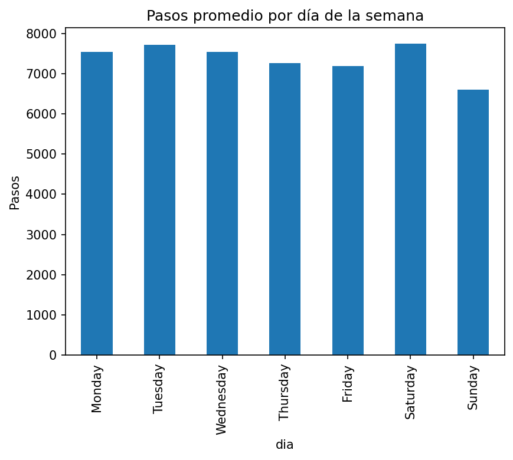
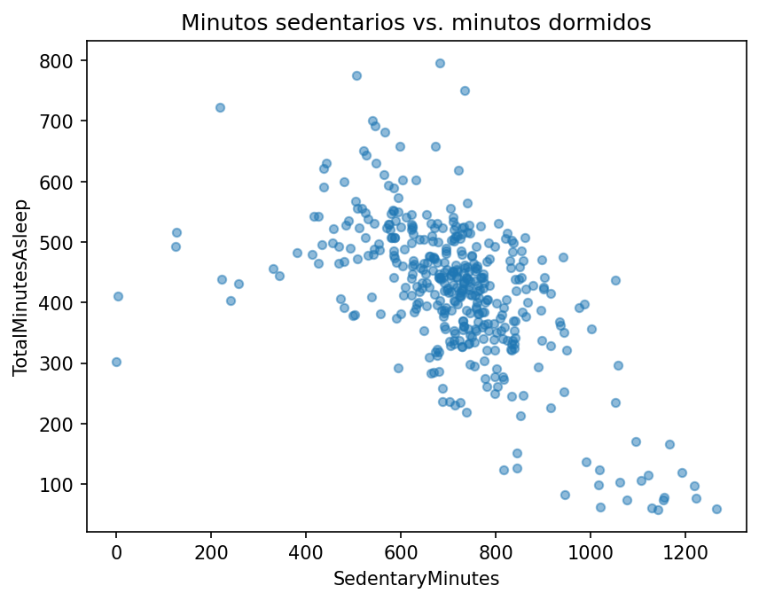

# Fitbit activity and sleep: what distinguishes low-activity days?
By: Alondra Belmonte

## Question and motivation

Which activity and sleep patterns distinguish low-activity days, and how well can those days be predicted from consumer wearable data?

Wearables and self-reported data are increasingly used in health research. This project is a small, complete analysis of one public wearable dataset, built to practice a careful workflow (cleaning, exploration, validated modelling) and to show clearly what the data can and cannot support.

## Data

- **Source:** [Fitbit Fitness Tracker Data](https://www.kaggle.com/datasets/arashnic/fitbit) (Möbius, Kaggle). Collected via an Amazon Mechanical Turk survey of Fitbit users who consented to share their tracker data.
- **Tables used:** daily activity and daily sleep. Everything else in the dataset (minute/hourly data, heart rate, weight) was left out of this version.
- **Period:** the dataset comes in two exports. Daily activity covers 2016-03-12 to 2016-05-12 (35 users). Daily sleep covers only the second export, 2016-04-12 to 2016-05-12 (24 users).
- **Final table:** one row per user-day with both activity and sleep, about 410 rows from 24 users.

The raw CSVs are not included in this repo. See [How to run](#how-to-run).

## Method

1. **Loading:** the two exports were combined into one table per category, keeping the source file of each row.
2. **Duplicates:**
   - Sleep: 3 identical rows were removed.
   - Activity: the two exports overlap on 2016-04-12, so each user appeared twice that day. The first export's row is a partial day (very few steps) and the second is a full day, so the row with more steps was kept.
3. **Dates:** converted to real dates in both tables and joined by user and date (inner join, so only days with both activity and sleep remain).
4. **Low-activity day:** a day with fewer than 5,000 steps. This is a common threshold for a sedentary lifestyle, and it flags about 23% of the user-days (96 of 410).
5. **Model:** logistic regression with minutes asleep, minutes awake in bed, and a Sunday indicator as predictors. Step counts and active minutes were deliberately excluded, since they define the outcome. Evaluated with 5-fold cross-validation grouped by user, so no user appears in both training and test folds, and reported as ROC AUC (the classes are imbalanced, so accuracy would be misleading).

## Findings

**Steps by day of the week.** Average steps are fairly stable from Monday to Saturday and drop on Sunday (roughly 6,600 versus 7,200 to 7,800 on the other days).



**Sedentary time and sleep.** Days with more sedentary minutes tend to have fewer minutes of sleep (correlation about -0.60). This is an association, not evidence that one causes the other.



**Prediction.** With grouped cross-validation, the model reached an AUC of 0.45, no better than random guessing. In this sample, one night's sleep and the day of the week do not predict low-activity days for users the model has not seen. Differences between people probably matter more than differences between days.

## Limitations

- **Small sample:** 35 users with activity data and 24 with sleep data. Each user contributes many similar days, so the ~410 user-days are not independent observations.
- **Old and self-selected data:** collected in 2016 from survey respondents who chose to share their data.
- **No demographics:** age, sex, health status and similar variables are not available, so results cannot be adjusted or generalised.
- **Sleep covers one month only:** the sleep table exists only for the second export, which limits the joined table.
- **Possible device artefacts:** some days show very high sedentary time with very little recorded sleep, which may be days the tracker was not worn or did not record properly. These were not removed.
- **Association, not causation:** the correlation between sedentary time and sleep says nothing about cause.
- **Threshold choice:** the 5,000-step cutoff is a convention; other cutoffs would change which days count as low activity.

## How to run

1. Download the dataset from Kaggle and place the CSV files in `data/raw/`. The two exports share file names, so the copies from the second export may appear with a ` (2)` suffix; the notebook looks for both versions.
2. Install the dependencies:

   ```
   pip install -r requirements.txt
   ```

   (pandas, matplotlib, scikit-learn, jupyter)
3. Open `analysis.ipynb` and run all cells from top to bottom. Figures are saved to `figures/`.
